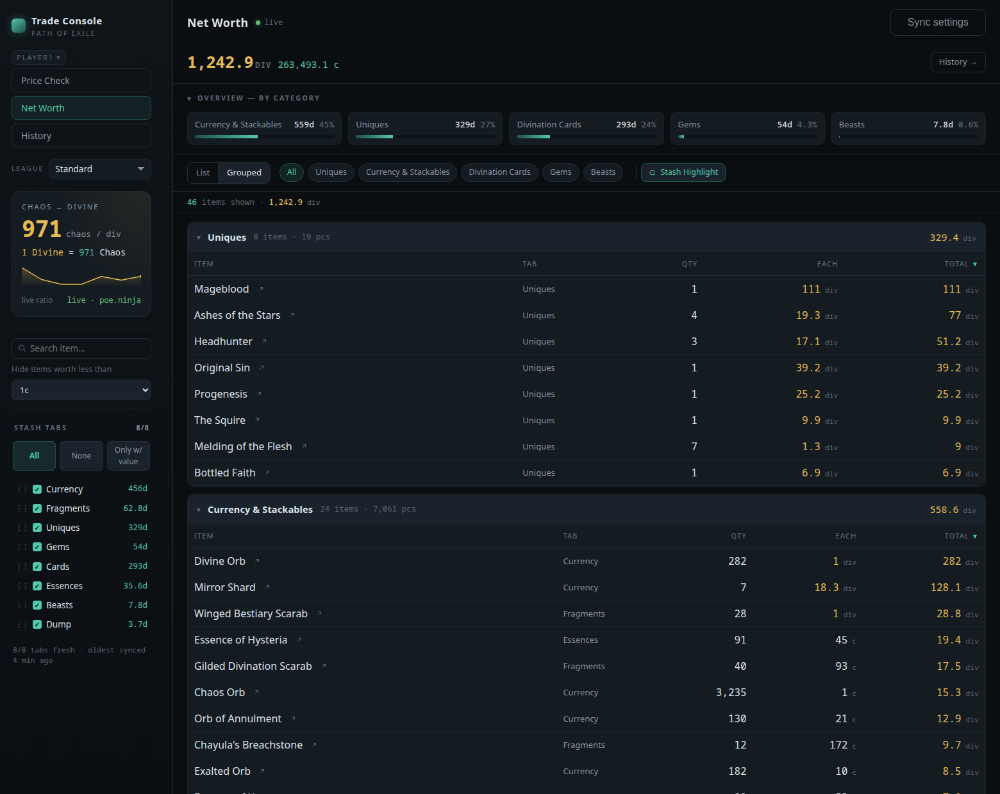
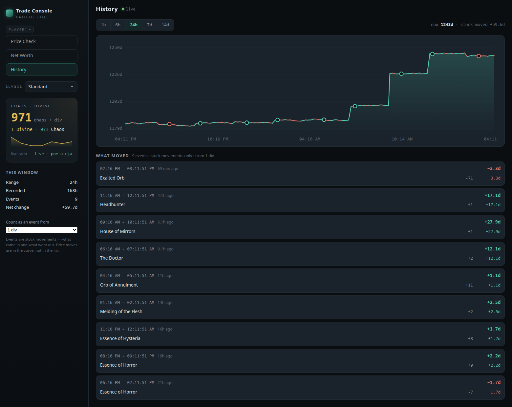

# poe-price-tool

> One-key item prices for **Path of Exile 1** — straight from the game into your browser.

Hover an item, press your key, see the price. No manual copy-paste, and no hunting for the right modifiers on the official trade site. A small, self-hosted setup: a Docker backend plus a hotkey daemon on your machine — the result shows up in a browser tab you keep open (a second monitor helps, otherwise you still alt-tab to look at it).

I run an Unraid server at home for several PoE players on Linux desktops. Awakened PoE Trade never ran well for me there — and broke on about every other update — so this is my kind-of-fork: its parsing engine, headless, behind a server everyone in the house can reach. None of this would exist without APT: years of work went into parsing PoE's item text and talking to the trade API correctly, and that part is theirs, kept as-is. Credit and thanks to [SnosMe](https://github.com/SnosMe/awakened-poe-trade) — go use the original if you are on Windows.

**Built and tested on exactly one setup:** Garuda Linux (Arch-based) with KDE Plasma 6 on Wayland, Path of Exile via Proton Experimental under XWayland, backend in Docker on Unraid. The backend is plain Docker and should run anywhere; the hotkey daemon leans on that specific stack (clipboard under XWayland, window focus, the `input` group). On another distro or desktop the pieces exist too, but nobody has tried it — see [the note above the prerequisites](#setting-up-the-hotkey).

## Features

- **One-key price check** — hover an item in-game → press a key → the recognized item appears in the browser with current trade prices (range plus a median, so one outlier listing can't make a worthless item look valuable). Toggle mods on and off to refine the search.
  - **Linked sockets** are filtered by default, capped at the item's own largest link group.
  - **Weapon DPS split** (Elemental/Physical) is shown alongside Total DPS — a 205 all-elemental weapon prices nothing like a 205 all-physical one.
  - **Corrupted items default to a corrupted-only search** — corruption puts an item in a separate market from its cheap non-corrupted twins.
  - **One click opens the same search on the official trade site** — with exactly the mods you have selected. The link carries the query id the trade API just returned, so it is the search the tool ran, not a rebuilt approximation: tick a mod, hit *Trade*, and refine it further over there.
  - **Quality and item level** on white bases are shown as read-only chips, since the engine already filters by them.
  - **Mods the tool can't recognize** (e.g. an obscure corruption implicit) are resolved against GGG's own stat catalogue and searched where possible; anything still unresolved is shown read-only instead of silently vanishing.
  - **Rate-limit safe** — if the shared trade queue hits a real GGG ban, an amber banner shows a live countdown and search is paused rather than firing more requests into the ban.
- **Market reference always in view** — live Chaos:Divine plus a rail of prices with mini histories. The current selection (Currency, Harvest Lifeforce, Einhar Beasts) is what *I* trade and watch; it is hardcoded in `backend/v2/server.mjs`, so a fork that cares about other things will want to change it.
- **Net-worth tracker** — read your whole stash (needs your POESESSID, see below) and get a total in Chaos and Divine, broken down per tab and category — no tab limits, unique stash included. Priced from the official GGG Currency Exchange (Faustus), poe.ninja, and the Trade API (itemised corpses) — how each category is valued: **[docs/pricing-logic.md](docs/pricing-logic.md)**. Server-side setup: **[docs/admin.md](docs/admin.md)**.
- **For multiple players** — one shared backend with a shared trade queue, separate rooms per user.

## What it looks like


*Price Check — the item arrives from the hotkey, the mod picker decides what the trade search asks for.*



*Net Worth — the whole stash valued, grouped by category, per tab and per item.*



*History — the curve over time, plus what actually moved in and out behind each step.*

## What is a POESESSID, and do I have to hand it over?

Only the net-worth tracker needs one — the price check works without any login.

`POESESSID` is the session cookie your browser gets when you log in at
pathofexile.com. It is what proves to GGG's servers that a request is *you*, so
it is worth treating like a password: whoever has it can act as your account on
the website for as long as it stays valid, including reading your stash. GGG has
no read-only variant, and their OAuth programme is closed to new developers, so
this cookie is the only way any third-party tool can see your stash at all —
that is a limitation of the platform, not a design choice here.

What this project does with it: it is stored in `/config/networth-users.json`
with `chmod 600`, it is used only to fetch your own stash tabs, and it is never
sent back to the browser, never logged and never included in any API response —
not even masked.

**Where it goes:** to `pathofexile.com` and nowhere else. The cookie is attached
in exactly one place in the code, on the stash request to GGG. The backend also
talks to poe.ninja, GGG's `poecdn` (the Currency Exchange feed) and RePoE (item
data) — none of those ever see it. There is no telemetry, no analytics, no
phone-home: the whole thing runs on your own machine or your own LAN, and the
only reason it reaches the internet at all is to ask those five hosts for
prices and game data. You can paste it in the browser UI or drop it in the file
yourself.

**It expires more often than you would expect.** Any fresh login invalidates the
old cookie — not just logging in on pathofexile.com, but also authorising a
third-party site through your PoE account (Filterblade and friends). So the
tracker stopping is usually not a bug: something re-authenticated somewhere and
your old POESESSID died with it. The tracker says so, pauses that user, and
picks up again once you paste the new value.

If that trade is not one you want to make: leave it out. Everything except the
net-worth page works without it.

## What it does in the background

Once running, the backend keeps working without a tab open: it syncs one stash
tab about every 30 seconds per configured user, and prices itemised corpses
at up to 25 trade-API requests per hour. All of it goes out over **your** IP —
the same one you browse pathofexile.com/trade with, and it counts against the
same rate limit. Both can be switched off (`POE_NETWORTH_AUTOSYNC=0`,
`POE_CORPSE_DISABLED=1`, see [docs/admin.md](docs/admin.md)).

Requests to the trade API also send a browser-like User-Agent. That is what the
vendored Awakened PoE Trade engine does; it is stated here so you know what runs
under your address.

## How it works

Two parts:

- a **backend** (Docker) that does the pricing and serves the web UI, and
- a small **hotkey daemon** (~24 KB) that runs on each gaming desktop: it copies the hovered item and sends it to the backend.

The backend can run on the **same PC you game on**, or **centrally on a home server** for several players. That's the only real choice — pick an install path below.

## Before you install: no authentication

The backend has **no login of any kind**. It binds to every interface, and the
only "identity" is a cookie you set yourself in the browser — so anyone who can
reach the port can read your account name, spend your trade-API rate limit, and
overwrite the stored POESESSID (which is a full session token for your PoE
account).

**Run it on a trusted LAN only, and never expose the port to the internet.** If
you put it behind a reverse proxy, put authentication in front of it.

## Install — Option A: everything on one PC

Backend and hotkey on the same Linux machine. The simplest setup.

1. Clone and start the backend (needs only Docker):

   ```bash
   git clone https://github.com/BriskWatchdogz1/poe-price-tool.git
   cd poe-price-tool
   docker compose up -d --build              # → http://127.0.0.1:8788
   ```

2. Open in your browser:

   |  |  |
   |---|---|
   | **Price Check** | <http://127.0.0.1:8788/> |
   | **History** | <http://127.0.0.1:8788/history.html> |
   | **Net Worth** | <http://127.0.0.1:8788/networth.html> |

3. Set up the hotkey ([see below](#setting-up-the-hotkey)) with `backend_url = http://127.0.0.1:8788`.

## Install — Option B: central server for several players

One shared backend on a home server (e.g. Unraid), each player on their own Linux desktop.

**On the server** — clone, set your player names, then build:

```bash
git clone https://github.com/BriskWatchdogz1/poe-price-tool.git
cd poe-price-tool
```

Set one room per player via `POE_USERS`, in a `docker-compose.override.yml`. You need to create this file yourself — it's already listed in `.gitignore`, so `git pull` stays clean. **These names are exactly what each player's daemon `user` must match** (step 3 below). Without this file the rooms default to `player1,player2`:

```bash
cat > docker-compose.override.yml <<'EOF'
services:
  poe-price-tool:
    environment:
      - POE_USERS=alice,bob        # your players' names
EOF
docker compose up -d --build                 # first build + start
curl -s http://127.0.0.1:8788/users          # → {"users":["alice","bob"]}
```

Put it behind a reverse proxy with **websockets enabled**.

Full server walkthrough — reverse proxy, `/config` permissions, all env vars: **[docs/admin.md](docs/admin.md)**.

**On each gaming desktop** — you only need the tiny hotkey daemon, nothing else from the repo (no backend, no Dockerfile). Check out **only** the `daemon/` folder:

```bash
git clone --filter=blob:none --no-checkout https://github.com/BriskWatchdogz1/poe-price-tool.git
cd poe-price-tool
git sparse-checkout set --no-cone daemon
git checkout
```

This leaves you with just `daemon/` — nothing the client doesn't use. Then set up the hotkey ([see below](#setting-up-the-hotkey)) with `backend_url = https://your-server`.

## Setting up the hotkey

> Run the commands below from **inside** the `poe-price-tool/` folder you cloned above. (`cd poe-price-tool` only works from its parent — if you're already inside the repo, you're set.)

A small daemon watches your **clipboard** and prices whatever PoE item lands in it — it doesn't inject any key presses, doesn't touch your input at all. You bind your own key to PoE's own copy shortcut (Ctrl+Alt+C); the daemon just reacts to what you copy.

> **Everything in this section assumes the tested stack** (see the top of this
> file): Arch-based, KDE on Wayland, PoE under XWayland. On another distribution
> the package names differ (`apt`, `dnf`, …) but the tools are the same. On X11
> instead of Wayland `ydotool` is unnecessary — `xdotool` alone can type the
> macros. On GNOME or another desktop the "custom shortcut" step lives elsewhere
> in the settings. None of that has been tried, so treat the specifics as a
> starting point rather than as verified.

**1. Prerequisites** (Arch/Garuda — adapt the package manager for your distro):

```bash
sudo pacman -S ydotool wl-clipboard xsel xdotool xorg-xprop python-evdev curl
sudo usermod -aG input $USER      # then log out and back in once
```

(`ydotool`/`xdotool`/`xorg-xprop`/`python-evdev` are only needed for the optional [chat macros](#chat-macros-optional) below. The price check itself needs `xsel` + `curl` — the daemon reads the clipboard via `xsel -b -o` first, since PoE runs under XWayland, and only falls back to `wl-clipboard`'s `wl-paste` if `xsel`/`DISPLAY` are unavailable. Installing all of it up front keeps this simple.)

**2. Install** — set up the daemon as a systemd user service:

```bash
./daemon/install.sh
```

**3. Configure — you must edit this.** `install.sh` already placed a config at `~/.config/poe-price-daemon/config.toml` (a copy of the example, with placeholder defaults). Note this is in your home directory — **not in the repo**: the repo only carries the `daemon/config.example.toml` template, while your live config lives outside it so `git pull` never overwrites your settings. **Open it and adjust it** — with the defaults it points at `127.0.0.1`, so for a server (Option B) it won't reach your backend until you change `backend_url`:

```toml
user = "player1"                        # must match a name in the server's POE_USERS (Option B step above)
backend_url = "http://127.0.0.1:8788"   # Option A (local); for a server use https://your-server
poe_window_class = "steam_app_238960"   # PoE detection, used by the chat macros — leave as-is for PoE1 on Steam
```

The daemon has no key binding of its own: it reacts to whatever lands in your clipboard, so the key is bound in the game (step 4). The file holds the rest — chat macros, ydotool socket — each with an inline comment. After editing, apply it:

```bash
systemctl --user restart poe-price-daemon
```

> **Behind a reverse proxy / HTTPS (Option B):** if `backend_url` points at an address the proxy forces onto HTTPS (http → 301 to https), **always write `https://`**. The POST deliberately does not follow redirects — with `http://` it receives the 301, does not follow it, and returns without ever reaching the backend. No error, no price, no log entry.

**4. Bind your key, in-game** (one-time): PoE keybind **"Advanced Mod Descriptions" = Alt**, client language **English**. Then bind a key of your choice to PoE's **copy item** action (Ctrl+Alt+C) — either directly in the game's keybind settings, as a **KDE Custom Shortcut** of type *Command/URL* running `xdotool key ctrl+alt+c` (KDE has no built-in "send another key combo" action), or in the software of a programmable input device if you use one. Hover an item, press your key → the item appears in the browser automatically, no further action needed.

> **Why a daemon at all?** The clipboard has no "something was copied" signal a script could wait for, so something has to watch it. That is all the daemon does: it polls a few times a second, and when a PoE item shows up it POSTs it to the backend (`daemon/poe-price-post.sh`). It has to keep running for that. The chat macros are optional — delete the `[macros]` section from `config.toml` and it only watches the clipboard.
>
> **What it reacts to, and what it ignores.** The two halves behave differently:
> - **Chat macros** only fire while Path of Exile has focus (checked via `xdotool`/`xprop` against `poe_window_class`). Your macro keys stay inert in every other window — pressing them in a browser does nothing.
> - **The price check does not check focus.** It watches the clipboard regardless of which window is active, and what filters it is the *content*: anything that does not start with `Item Class: ` is dropped. So copying normal text anywhere changes nothing — but copying a PoE item text from Discord or a wiki page **will** price it. That is deliberate: PoE runs under XWayland and its copies land in the X11 clipboard, which the daemon reads directly to sidestep a flaky clipboard bridge; adding a focus check would mean another `xdotool` call several times a second.

### Chat macros (optional)

The same daemon can also bind keys to chat commands — open chat, type the command, send it — like APT/SlimTrade's macro keys. Configured in the same `config.toml`, `[macros]` section:

```toml
[macros]
keyboard_layout = "us"     # "us" | "de" — so chat commands type correctly under KWin
chat_open_delay_ms = 45
keystroke_delay_ms = 12
[macros.keys]              # key -> chat command (freely extendable)
F5 = "/hideout"
F6 = "/kingsmarch"
F7 = "/delve"
F8 = "/menagerie"
F9 = "/monastery"
```

Set `keyboard_layout` to match your in-game client keyboard layout — chat commands are typed via kernel-level key injection, which KWin then interprets according to the active layout, so it has to match to produce the right characters. Remove the `[macros]` section entirely to disable macros — the daemon then runs price-check only.

The daemon itself lives in `daemon/` in this repo, and every setting — backend, user, window class, macros — is in `config.toml` / [`daemon/config.example.toml`](daemon/config.example.toml): fully customizable, nothing hardcoded.

### Daemon troubleshooting

Check logs first: `journalctl --user -u poe-price-daemon -f`

| Symptom | Likely cause / fix |
|---|---|
| Nothing happens on copy, no errors in the log | Wrong `backend_url` in `config.toml` — verify it's reachable (`curl <backend_url>/health` → `ok`). |
| The POST returns immediately, but no price appears and the backend log stays silent | `backend_url` is `http://` but the reverse proxy 301-redirects to `https://`. The daemon deliberately doesn't follow redirects, so curl accepts the 301 and stops there. Use `https://` in `config.toml` (see the note in step 3 above). |
| Chat macros don't fire, or price check itself is silent | You're not in the `input` group (evdev needs `/dev/input/event*` access) — `sudo usermod -aG input $USER`, then log out and back in. |
| Price check works, but only when the game window has focus in an unusual way / feels less reliable than expected | `xsel` isn't installed, so the daemon fell back to `wl-paste`, which doesn't reliably see XWayland (PoE) clipboard changes — install `xsel` (see prerequisites above) and restart the daemon. |

## Development

```bash
npm ci && npm --prefix renderer ci
node backend/v2/build.mjs                      # bundles the vendored APT engine
cd renderer && node src/assets/make-index-files.mjs && cd ..   # search indices
npm test
```

Both build steps are required before the first `npm test`: the engine bundle and
the `.index.bin` search indices are generated artifacts and are not checked in.
The suite is ~586 tests and needs no network for the bulk of it.

## For admins

Architecture, example Unraid deployment (git-pull workflow), and server config: **[docs/admin.md](docs/admin.md)**.

## Known issues

- **KDE/Klipper + images:** copying an image (e.g. a screenshot) stalls the clipboard read until you open the clipboard history once (Meta+V). It's a KDE clipboard bug, not the tool — normal item-checking is unaffected.
- **A brand-new unique isn't recognised:** the bundled item database is older than the patch that added it. The admin refreshes it with `npm run update-apt-data` and redeploys — see [docs/admin.md](docs/admin.md#league-start-runbook).

## Credits

Item parsing and trade integration come from [Awakened PoE Trade](https://github.com/SnosMe/awakened-poe-trade) (MIT license, © Alexander Drozdov) and run here headless. See [LICENSE](LICENSE).

**This is AI-written code, and that is not hidden here.** The backend, the browser UI, the hotkey daemon, the tests and this documentation were written by Claude (Anthropic), working from my requirements, my bug reports and my judgement about what the tool should do — I specified, tested and decided; Claude wrote. Every design decision, every measurement quoted in the docs and every fix went through that loop. If that is a dealbreaker for you, you know it before you clone rather than after.

Price data comes from [poe.ninja](https://poe.ninja) (cached for at least 15
minutes, as their usage policy asks), from GGG's public Currency Exchange
digest, and from the official [PoE Trade API](https://www.pathofexile.com/trade).
Item and stat data derives from [RePoE](https://github.com/lvlvllvlvllvlvl/RePoE).

This is an unofficial fan-made tool. It is not affiliated with, endorsed by, or
sponsored by Grinding Gear Games. Path of Exile is a trademark of Grinding Gear
Games. Use it for your own account at your own risk.
